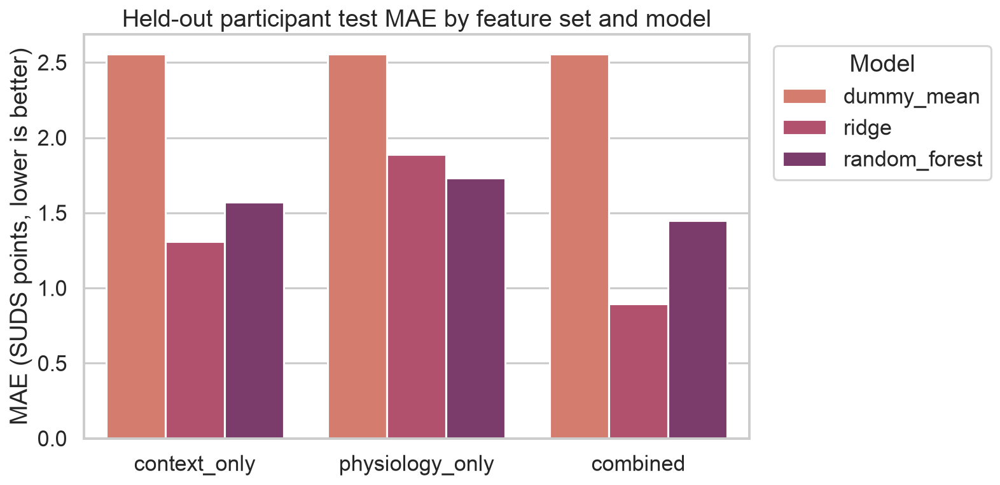
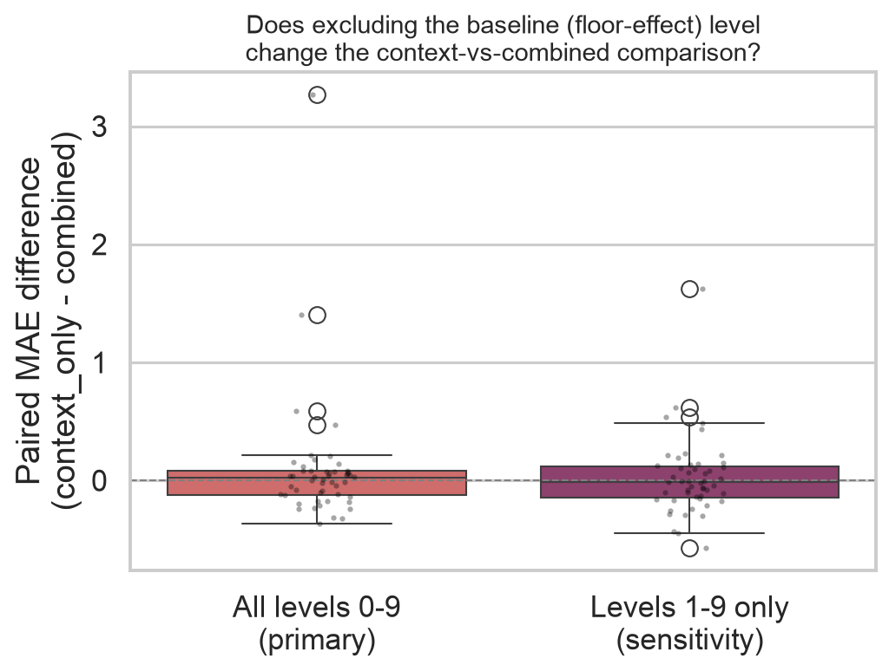

# Predicting Fear During Virtual Reality Exposure

A small-sample behavioral/physiological machine-learning study: this project explores
whether physiological signals contain useful information about self-reported fear during
VR spider exposure, and how that fear-related information compares with simply knowing
the exposure stage a participant is in.

It is a student portfolio project (Computer Science + Psychology) demonstrating an
end-to-end, leakage-safe ML pipeline on a real, publicly available psychophysiology
dataset -- not a clinical tool and not a production prediction system.

## Motivation

**Psychological:** In VR exposure therapy for phobias, a therapist typically calibrates
exposure intensity using what the client reports. Physiological signals (heart rate, skin
conductance) are sometimes proposed as an additional, more continuous source of
information a system could use alongside self-report. But physiological arousal and
subjective fear are not the same thing -- they can dissociate, as the dataset's own title
suggests ("Do Virtual Spiders Feel Real? Dissociation Between Subjective and Physiological
Fear During VR Exposure"). This project treats that dissociation as a first-class research
question rather than assuming physiology is a proxy for fear.

**Technical:** The project demonstrates a repeated-measures ML workflow done correctly at
small sample size: participant-aware splitting/cross-validation (no participant leakage),
honest use of precomputed vs. raw physiological data, an explicit three-way feature-set
comparison, and transparent reporting of results that don't look like a polished
commercial demo (because they shouldn't, at N=28).

## Research questions

1. **Primary:** Can physiological signals recorded during virtual spider exposure predict
   a participant's self-reported fear level?
2. **Secondary:** Do physiological responses and subjective fear tell the same story, or
   is there a meaningful dissociation between them?

## What this project is **not**

It does not diagnose a phobia, does not replace self-report, does not make treatment
decisions, and is not a clinical system. See "Responsible use" below and
`reports/model_card.md` for the full scope statement.

## Dataset

**Krumnikl, M., Nemec, M., Vilímková, A., Huser, F., & Jaremová, V. (2026).** Dataset for
*"Do Virtual Spiders Feel Real? Dissociation Between Subjective and Physiological Fear
During Virtual Reality Exposure"* [Data set]. Zenodo.
[https://doi.org/10.5281/zenodo.20796399](https://doi.org/10.5281/zenodo.20796399)

- **License:** CC-BY-4.0 (verified via the Zenodo API on 2026-08-20; open access, single
  ~467 MB archive, MD5-checksum-verified on download)
- **Participants:** 28 (pseudonymized ids `P04`-`P31`)
- **Unit of observation:** one (participant, VR exposure level) pair -- **280
  observations** (28 participants x 10 levels: level 0 = neutral baseline, levels 1-9 =
  escalating spider-exposure tasks)
- Full documentation, exact column definitions, sampling rates, exclusions, and licensing
  detail: [`data/README.md`](data/README.md)

## Physiological measurements used

Precomputed per-level features from the dataset authors (used honestly rather than
reprocessed, given the raw recordings are ~9 GB total -- see "Signal processing" below):
heart rate and HRV (SDNN, RMSSD, LF/HF) from PPG, smartwatch heart rate plus derived
reactivity/trend/range statistics, respiratory rate, and mean electrodermal activity (EDA)
-- each also expressed as a **change from the participant's own level-0 baseline**.

## Prediction target

`suds`: self-reported **Subjective Units of Distress** (0-10 continuous scale), collected
once per exposure level. This is a genuine subjective-fear rating present in the source
data -- **not** the VR condition/level relabeled as a proxy, and not derived from
physiology. Modeled as **regression** (the preferred task per the project brief, since the
rating is a genuine continuous self-report, not an artificially binned category).

## Signal processing and feature-extraction decisions

- **Main pipeline:** uses the dataset authors' precomputed per-level physiological
  features (`summary.csv`), plus baseline-corrected deltas computed by this project
  (`vr_fear_prediction.data.reshape_wide_to_long`). This is the honest choice given the
  raw data's size (150 MB-1.2 GB per participant, ~9 GB total) -- reprocessing all of it is
  impractical for a student project or CI.
- **Raw-signal demonstration:** `src/vr_fear_prediction/signal_processing.py` implements a
  real NeuroKit2-based extraction pipeline (EDA tonic/phasic decomposition + SCR
  detection, PPG peak-based heart rate and RMSSD, respiration rate), unit-tested with
  small synthetic fixtures (`tests/test_signal_processing.py`), and demonstrated on one
  real participant's raw recording in `notebooks/01_exploration.ipynb` as a sanity check
  against the official precomputed values. **RMSSD is only computed when a window is at
  least 30 seconds long and contains at least 15 detected beats**; shorter windows return
  `NaN` rather than an unreliable number.
- **Baseline correction:** every physiological feature is also expressed as
  `value_at_level_N - value_at_level_0` for the same participant, controlling for large
  between-participant differences in resting physiology (see the notebook's
  within-/between-participant variance analysis).

## Participant-aware validation strategy (leakage prevention)

Every participant contributes 10 rows (one per exposure level). **All splitting and
cross-validation groups by `participant_id`** (`vr_fear_prediction.splitting`):

- A `GroupShuffleSplit` holds out ~20% of participants entirely for a final held-out test
  -- no participant appears in both train and test.
- Model/hyperparameter selection uses `GroupKFold` cross-validation *on the training
  participants only*.
- All preprocessing (imputation, scaling, one-hot encoding) is fit inside a scikit-learn
  `Pipeline`, so it only ever sees training folds.
- `tests/test_splitting.py` asserts no participant overlap under both the held-out split
  and every `GroupKFold` fold; `tests/test_features.py` asserts the target and participant
  id are never present in the feature matrix.

**Other leakage risks identified and excluded** (full list and reasons in
[`data/README.md`](data/README.md) and `vr_fear_prediction.data.LEAKAGE_EXCLUDED_COLUMNS`):
post-exposure questionnaire scores (measured *after* the session, would leak the outcome),
cortisol (sampling times don't align with individual levels), sensor cross-agreement QA
metrics, free-text post-session reflections, and the two SUDS ratings with no matching
physiological feature block.

## Model comparison: context-only vs. physiology-only vs. combined

Three feature sets, compared head-to-head, to test whether physiology adds predictive
value beyond simply knowing the exposure stage and the participant's trait questionnaire
scores:

- **context_only**: exposure level + trait/demographic questionnaire scores (SPQ, STAI
  trait/pre-exposure state anxiety, age, gender, prior VR/AR experience, spider fear/
  contact history). No physiological measurement.
- **physiology_only**: the precomputed physiological features + baseline deltas above.
- **combined**: union of both.

Each is evaluated with `DummyRegressor` (mean baseline), `Ridge` (regularized linear,
`alpha` tuned via a small `GridSearchCV` grid), and `RandomForestRegressor` (`max_depth`/
`min_samples_leaf` tuned via the same small grid) -- see `vr_fear_prediction.modeling` for
the exact search spaces.

## Results

From a completed run of `python -m vr_fear_prediction.modeling`, reported in full (all
models, both CV and held-out-test metrics, plus the robustness checks below) in
[`reports/metrics.json`](reports/metrics.json).

| Feature set | Best model (by CV) | CV MAE (mean ± sd) | Held-out test MAE | Held-out test RMSE | Held-out test R² |
|---|---|---|---|---|---|
| context_only | Ridge (α=10) | 1.82 ± 0.12 | 1.31 | 1.86 | 0.19 |
| physiology_only | Dummy (mean) | 2.37 ± 0.51 | 2.56 | 2.82 | -0.86 |
| combined | Ridge (α=50) | 2.09 ± 0.20 | **0.89** | **1.36** | **0.57** |

(Dummy-mean baseline, shown for reference: CV MAE 2.37 ± 0.51, held-out test MAE 2.56,
R² -0.86 -- identical across feature sets, as expected, since it ignores all features.)
**Physiology alone is weak**: no model beats the dummy baseline on physiology_only under
cross-validation, and only modestly on the held-out test -- consistent with the source
paper's central finding that subjective and physiological fear are related but
substantially dissociated.

### Does physiology add value beyond context? Verdict: inconclusive

On this single held-out split, `combined` (MAE 0.89) beats `context_only` (MAE 1.31). But
under participant-aware cross-validation, the ranking **flips**: `context_only` (CV MAE
1.82) beats `combined` (CV MAE 2.09). A single six-participant test set is not
automatically more informative than a five-fold, ~22-participant cross-validation
estimate, so this project does not treat either number alone as the answer.

To find out whether the single-split result is a stable pattern or an artifact of which
six participants happened to be held out, we ran the same context-only-vs-combined Ridge
comparison across **50 repeated outer `GroupShuffleSplit`s** with different seeds (holding
out different participants each time; alpha re-selected each time using only the outer
training participants -- see "Repeated participant-level holdout evaluation" below). The
result: **combined had a lower MAE in only 54% of the 50 splits** -- essentially a coin
flip -- and the 95% interval on the paired MAE difference (`-0.32` to `+1.22`) straddles
zero.

> **Evidence that physiology adds predictive value beyond context is inconclusive.** The
> combined model performs better on one held-out participant split, but worse under
> participant-aware cross-validation. With only 28 participants, this difference is
> unstable and may depend strongly on which participants are held out.

This exact conclusion is also written into `reports/metrics.json` under
`physiology_value_assessment.summary`, generated by
`vr_fear_prediction.robustness.build_physiology_value_assessment` from whichever of three
outcomes (`inconclusive`, `combined_likely_better`, `context_only_likely_sufficient`) the
evidence actually supports -- it is not a fixed string.

### Repeated participant-level holdout evaluation

`vr_fear_prediction.robustness.repeated_participant_holdout` reruns the context-only vs.
combined Ridge comparison 50 times, each time holding out a different ~20% of
participants, with alpha re-selected each time using an inner `GroupKFold` on the outer
*training* participants only (never the held-out ones). Full per-split results:
[`reports/repeated_holdout_results.csv`](reports/repeated_holdout_results.csv).

| | MAE mean | MAE median | MAE std |
|---|---|---|---|
| context_only | 1.90 | 1.86 | 0.61 |
| combined | 1.82 | 1.82 | 0.34 |

Paired difference (`context_only_MAE - combined_MAE`, positive favors combined): mean
**+0.08**, median **+0.02**, 95% interval **[-0.32, +1.22]**, combined better in **54% /
50** splits. A distribution centered near zero that crosses zero is the signature of an
unstable comparison, not a reliable winner -- see the figure below.

### Sensitivity analysis: excluding baseline

Level 0 (the neutral pre-exposure baseline) has a strong SUDS floor effect -- most
participants report 0 fear there -- and every baseline-corrected physiological delta is
*trivially* 0 at level 0 by construction, which could make prediction artificially easy.
As a **secondary, clearly-labeled sensitivity check** (not a replacement for the primary
analysis), we reran the full comparison and the 50-split repeated holdout using only
exposure levels 1-9 (252 of the 280 observations):

| | Held-out test MAE (context) | Held-out test MAE (combined) | CV MAE (context) | CV MAE (combined) | Repeated-holdout: combined better |
|---|---|---|---|---|---|
| Primary (levels 0-9) | 1.31 | 0.89 | 1.82 | 2.09 | 54% |
| Sensitivity (levels 1-9 only) | 1.34 | 1.07 | 1.82 | 2.07 | 42% |

**Conclusion does not materially change**: excluding the baseline level still yields
`overall_conclusion: "inconclusive"`, and the repeated-holdout "combined better" fraction
shifts by only -12 percentage points (54% -> 42%), well within the noise this project
already treats as expected at N=28. The floor effect makes the numbers slightly easier
overall (both models improve on CV) but does not resolve the context-vs-combined
disagreement. Full results: `reports/metrics.json` -> `sensitivity_excluding_baseline`,
and [`reports/repeated_holdout_results_excluding_baseline.csv`](reports/repeated_holdout_results_excluding_baseline.csv).

## Figures


*Self-reported fear rises with exposure level with a clear floor effect at baseline; the
physiological measure (EDA) shows a related but visibly noisier pattern.*


*Per-participant mean self-reported fear vs. mean physiological reactivity during
exposure (both z-scored). Points near the diagonal show agreement; points far from it
(labeled) show dissociation -- some participants report high fear with little
physiological change, or vice versa.*



*The three-way feature-set comparison **on the single original held-out split only**:
physiology alone rarely beats the dummy baseline. Read this figure together with the next
one -- on this one split combined looks like a clear win, but that is not the full
picture.*


*Paired MAE difference (context_only - combined) across 50 repeated participant-level
holdout splits. Positive bars favor combined, negative bars favor context-only. The
distribution straddles zero and is centered near it (54% of splits favor combined) --
this is the honest picture behind the single-split result above, and it shows that
comparison is not reliably won by either feature set at this sample size.*



*The same paired-difference distribution, computed with all levels (primary, left) vs.
with the level-0 floor-effect observations excluded (sensitivity, right). Both are
centered near zero -- excluding baseline does not resolve the instability.*

Additional figures (predicted-vs-observed, residuals, permutation importance -- generated
both for the CV-selected best feature set and for `combined` specifically) are in
[`reports/figures/`](reports/figures/).

## Interpretation

- **Permutation importance** (computed on held-out participants only,
  `reports/figures/permutation_importance*.png` and `reports/permutation_importance*.csv`)
  identifies `SPQ_F` (Fear/Disgust Reaction subscale of the Spider Phobia Questionnaire)
  as the strongest predictor in the context-only model -- a psychologically sensible
  result (trait spider-related fear/disgust predicts state fear during spider exposure).
- **Standardized Ridge coefficients** for the combined model
  (`reports/ridge_coefficients_combined.csv`) are directly comparable in magnitude because
  all numeric inputs are standardized and categoricals one-hot encoded inside the
  pipeline.
- Feature importance here identifies **association, not causation**. Physiological
  arousal is not unique to fear (effort, excitement, novelty, and sensor motion artifacts
  can all raise heart rate or EDA) -- a rise in these signals is not proof that someone is
  afraid. Individual physiological baselines vary substantially (see the notebook's
  within-/between-participant variance analysis), which is exactly why this project models
  baseline-corrected deltas alongside raw levels rather than raw values alone.

## Reproduction

```bash
python3 -m venv .venv
source .venv/bin/activate
pip install -r requirements.txt

python -m vr_fear_prediction.download_data          # fetch summary.csv (~467 MB download, ~few hundred KB extracted)
python -m vr_fear_prediction.data                   # validate + reshape -> data/processed/features_long.csv
python -m vr_fear_prediction.modeling                # train/evaluate all models + robustness checks (~90s) -> reports/metrics.json, reports/figures/, reports/*.csv, models/best_pipeline.joblib
pytest -v                                            # run the test suite (uses small local fixtures, no download needed)
```

`vr_fear_prediction.modeling` now also runs the 50-split repeated participant holdout and
the baseline-exclusion sensitivity analysis (each of which is itself another 50 splits),
which is why a full run takes roughly a minute and a half rather than a few seconds.

Optional, for the raw-signal-processing demo in the notebook:

```bash
python -m vr_fear_prediction.download_data --with-raw-signals p31   # fetch one raw recording (~150 MB)
jupyter notebook notebooks/01_exploration.ipynb
```

All randomness is seeded (`vr_fear_prediction.splitting.RANDOM_SEED = 42`,
`vr_fear_prediction.robustness.DEFAULT_BASE_SEED = 1000`); re-running
`vr_fear_prediction.modeling` reproduces `reports/metrics.json` exactly.

## Repository structure

```text
vr-fear-response-prediction/
├── .github/workflows/tests.yml       # CI: installs deps, runs pytest
├── data/
│   ├── README.md                     # full dataset documentation, citation, exclusions
│   ├── raw/                          # downloaded from Zenodo (gitignored)
│   ├── interim/                      # reserved (gitignored)
│   └── processed/features_long.csv   # reshaped (participant, level) table (committed)
├── models/best_pipeline.joblib       # the CV-selected fitted pipeline
├── notebooks/01_exploration.ipynb    # EDA, dissociation analysis, raw-signal demo
├── reports/
│   ├── figures/                      # generated plots
│   ├── metrics.json                  # full results (feature sets x models, robustness checks, sensitivity analysis)
│   ├── repeated_holdout_results.csv          # 50-split context-vs-combined comparison, all levels
│   ├── repeated_holdout_results_excluding_baseline.csv  # same, levels 1-9 only (sensitivity)
│   ├── permutation_importance*.csv
│   ├── ridge_coefficients_combined.csv
│   └── model_card.md
├── src/vr_fear_prediction/
│   ├── download_data.py              # Zenodo download + checksum verification
│   ├── data.py                       # load, validate, reshape wide -> long
│   ├── signal_processing.py          # NeuroKit2 raw-signal feature extraction
│   ├── features.py                   # context/physiology/combined feature matrices
│   ├── splitting.py                  # participant-aware split/CV helpers
│   ├── modeling.py                   # pipelines, GridSearchCV, evaluation orchestration
│   ├── robustness.py                 # repeated-holdout stability check + baseline-exclusion sensitivity analysis
│   ├── evaluation.py                 # metrics, permutation importance, rm-correlation
│   └── visualization.py              # all plotting functions
├── tests/                            # pytest suite, small local fixtures only (includes test_robustness.py)
├── LICENSE                           # MIT (code only; data is CC-BY-4.0, see data/README.md)
├── requirements.txt
└── pyproject.toml
```

## Limitations

- **N = 28 participants** -- every metric here has wide uncertainty; treat point estimates
  as illustrative, not precise.
- **Whether physiology adds predictive value beyond context is inconclusive on this
  dataset.** A single held-out test split favored the combined model; participant-aware CV
  favored context-only; a 50-split repeated holdout evaluation put combined ahead only 54%
  of the time, with a 95% interval on the paired MAE difference that straddles zero. A
  sensitivity check excluding the baseline floor-effect level did not change this. See
  "Results" above. This is a genuine finding, not a gap in the analysis -- but it does mean
  this project cannot claim physiology reliably improves prediction over context alone.
- **The repeated-holdout evaluation resamples the same 28 participants** across different
  train/test splits -- it quantifies how sensitive the comparison is to *which* held-out
  participants are chosen, but it is not equivalent to testing on independent new
  participants, and cannot fully substitute for a larger sample.
- **Hyperparameter selection and CV performance estimation share the same folds** (not a
  fully nested CV), which is somewhat optimistic; full nesting was judged impractical at
  N≈22 training participants.
- **The from-scratch raw-signal demo does not closely match the official precomputed
  features** in absolute terms (see the notebook) -- disclosed as an honest finding, not
  hidden.
- Results are specific to this VR spider-exposure protocol, this sensor hardware, and this
  population; they do not generalize to other phobias, VR content, devices, or clinical
  populations without independent validation.

See `reports/model_card.md` for the complete limitations and ethical-considerations
discussion.

## Responsible use

> This project explores whether physiological signals contain useful information about
> self-reported fear during VR exposure.

It does **not** claim to accurately detect fear, does not diagnose a phobia, and cannot
replace a participant's own report or a clinician's judgment. Physiological arousal is not
unique to fear and should never be treated as ground truth that overrides what a person
says about their own internal state.

## Future integration with adaptive VR exposure systems

A cautious, research-only direction this project's results *could* motivate, if a larger
future sample confirmed physiology adds value: an adaptive exposure system might use a
model like `combined` as **one additional signal** alongside continuous self-report (not a
replacement for it) when deciding whether to hold, advance, or step back the exposure
intensity -- always with the participant able to override the system via their own report,
and always under clinical supervision. This project does not implement, validate, or
recommend deploying such a system, and its own results do not yet establish that
physiology-plus-context reliably beats context alone (see "Results" above) -- that
question remains open pending a larger sample.
