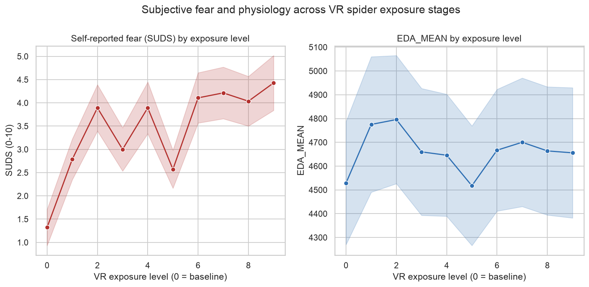
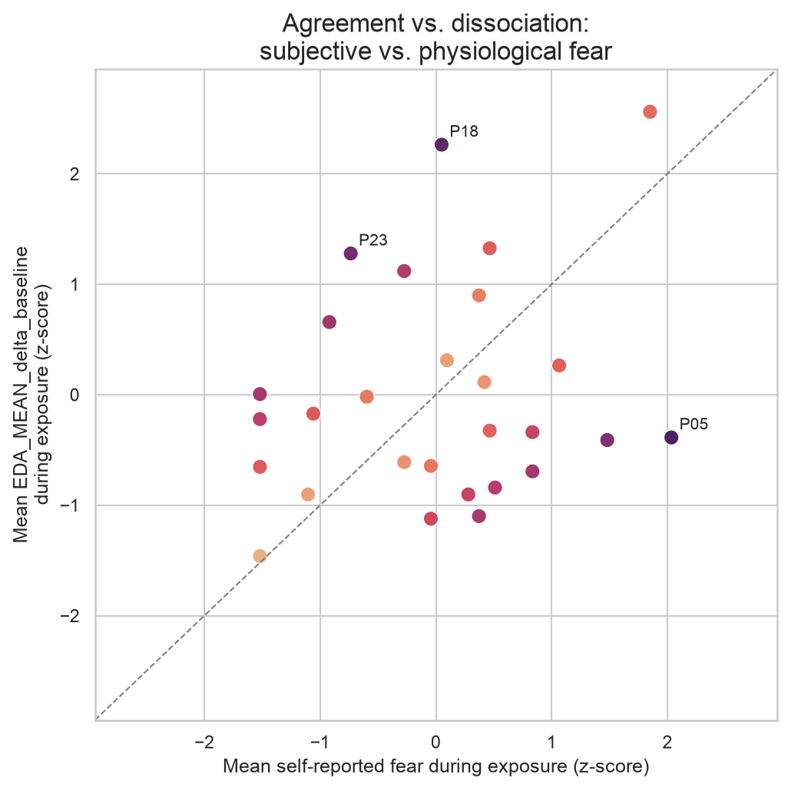
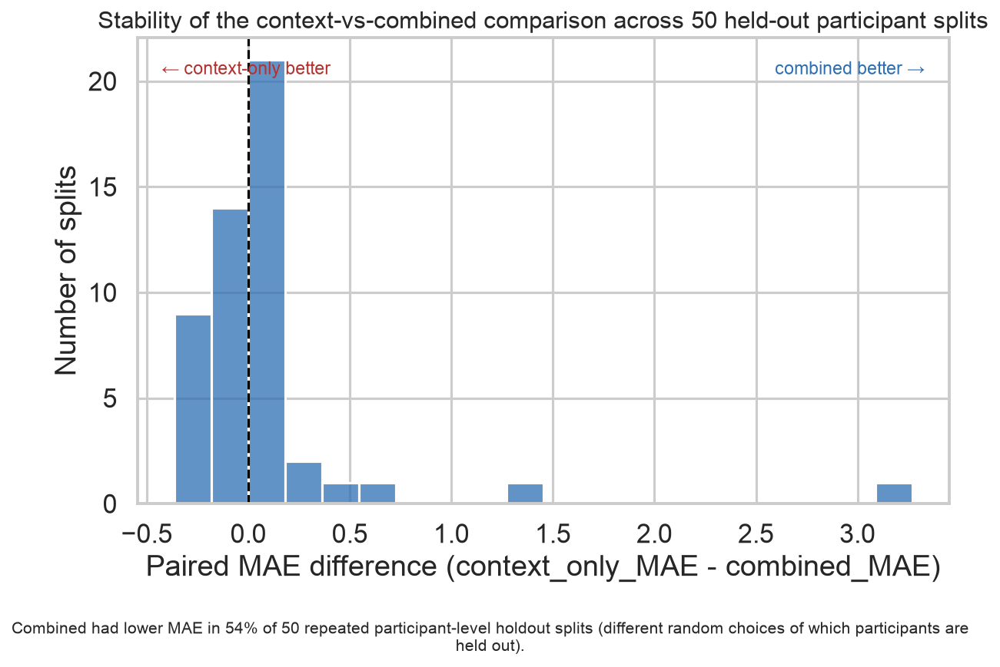

# Predicting Fear During Virtual Reality Exposure

I had already been working on a VR exposure therapy project and wanted to explore a
related question: can physiological measurements tell us anything useful about how
afraid someone feels during exposure? Heart rate and skin conductance are sometimes
brought up as a way to give exposure systems more information than just asking someone
how they feel, but I wasn't sure how much they'd actually add on top of simply knowing
the exposure stage and a bit about the person going into the session. That's the question
this project tries to answer:

> Can physiological features improve prediction of self-reported fear during virtual
> spider exposure, beyond exposure context and pre-session questionnaire information?

## Dataset

I used a public dataset from Krumnikl et al. (2026), ["Do Virtual Spiders Feel Real?
Dissociation Between Subjective and Physiological Fear During Virtual Reality
Exposure"](https://doi.org/10.5281/zenodo.20796399) (Zenodo, CC-BY-4.0). 28 participants
each went through 10 VR exposure levels — a neutral baseline followed by nine
spider-exposure tasks of increasing intensity — giving 280 repeated observations. Each
level has precomputed physiological features (heart rate, HRV, EDA, respiration) plus a
self-reported fear rating (SUDS, 0-10).

Full column definitions, sampling details, and the citation are in
[`data/README.md`](data/README.md).

## What I compared

After reshaping the dataset from one-row-per-participant to one-row-per-(participant,
level) with pandas, I built three feature sets from it:

- **context only** — the exposure level plus questionnaire scores collected before the
  session (spider fear/disgust questionnaire, trait anxiety, demographics). No physiology.
- **physiology only** — heart rate, HRV, EDA, and respiration features for that level,
  plus each one's change from the participant's own baseline level.
- **combined** — both together.

For each feature set I compared a dummy (mean) baseline, Ridge regression, and a random
forest, using scikit-learn `Pipeline`s so imputation, scaling, and encoding are always
fit on training data only, never on the held-out participants.

## Validation approach

Every participant contributes 10 rows, so a random row-level split would put the same
person's data in both training and test, which would let a model quietly learn who a
participant is rather than how physiology relates to fear. All splitting here is by
participant instead: `GroupShuffleSplit` holds out a set of participants entirely for
testing, and `GroupKFold` selects hyperparameters using the training participants only.

Because a single train/test split of 28 participants is small, I also reran the
context-vs-combined comparison across 50 different participant splits (a repeated
participant holdout), and reran that again after excluding the baseline level, since
level 0 has a strong floor effect — most participants report zero fear there — that could
make prediction look easier than it is.

## Main results

| Feature set | Best model | CV MAE | Held-out test MAE |
|---|---|---|---|
| context only | Ridge | 1.82 | 1.31 |
| physiology only | Dummy | 2.37 | 2.56 |
| combined | Ridge | 2.09 | 0.89 |

Evidence that physiology adds predictive value beyond context is inconclusive. The
original held-out split favored the combined model, but participant-aware
cross-validation favored context-only. Across the 50 repeated participant splits, combined
won only 54% of the time, and the interval on the paired MAE difference crossed zero.
Excluding the baseline level didn't resolve this either. Physiology on its own barely beat
the dummy baseline under cross-validation, which fits the dataset's own framing:
subjective and physiological fear are related but don't move together closely.

Full numbers are in [`reports/metrics.json`](reports/metrics.json),
[`reports/repeated_holdout_results.csv`](reports/repeated_holdout_results.csv), and
[`reports/model_card.md`](reports/model_card.md).

## Figures



Self-reported fear rises with exposure level; EDA follows a related but noisier pattern.



Per-participant fear vs. physiological reactivity. Points near the diagonal agree; points
far from it don't.



The paired MAE difference across 50 repeated participant splits, centered close to zero.

## How to run

```bash
python3 -m venv .venv
source .venv/bin/activate
pip install -r requirements.txt

python -m vr_fear_prediction.download_data   # ~467 MB download
python -m vr_fear_prediction.data
python -m vr_fear_prediction.modeling        # ~90 seconds, writes reports/
pytest -v
```

`notebooks/01_exploration.ipynb` walks through the dataset and the modeling result.

## Repository structure

```text
vr-fear-response-prediction/
├── data/README.md              # dataset details, citation, license
├── notebooks/01_exploration.ipynb
├── reports/                    # metrics.json, model_card.md, figures, repeated-holdout results
├── src/vr_fear_prediction/     # data prep, features, modeling, robustness, visualization
├── tests/
└── requirements.txt
```

## Limitations

- Only 28 participants — every number here has wide uncertainty.
- Repeated observations per participant limit how far this generalizes even within the
  dataset.
- Physiological arousal isn't a direct measurement of fear — it responds to plenty of
  things besides it.
- The results don't reliably show that physiology improves prediction over context alone.
- Everything here is specific to this spider-exposure dataset and protocol; it's
  exploratory work, not a clinical system. A much larger sample would be needed before
  physiological measurements could be considered for adaptive VR exposure.
